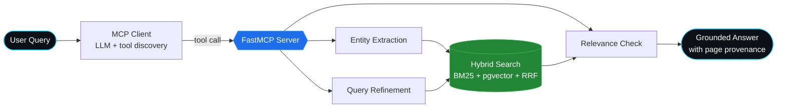

<!-- ═══════════════ HEADER BANNER ═══════════════ -->
<div align="center">


<a href="https://github.com/anikettt-cd">
  
</a>

<br/><br/>

<a href="https://linkedin.com/in/it-aniketsaini"></a>
<a href="mailto:sainianiket751@gmail.com"></a>
<a href="https://github.com/anikettt-cd?tab=repositories"></a>


</div>

<br/>

<!-- ═══════════════ ABOUT ═══════════════ -->
## 👨‍💻 About Me

```python
class Aniket:
    role      = "Python Backend & Full-Stack Engineer"
    education = "B.E. Information Technology  |  CGPA 8.95 / 10  |  Class of 2027"
    college   = "Pillai HOC College of Engineering & Technology"
    experience = "Python Full-Stack Developer Intern @ Viraj Profiles Ltd."
    focus     = ["FastAPI", "Distributed Systems", "Agentic RAG", "MCP", "ETL"]
    building  = "CloudHeal: a self-healing infrastructure framework"
    status    = "Open to entry-level Python / Backend roles 🚀"
```

<table>
<tr>
<td width="50%" valign="top">

### 🔭 Currently Building
**[CloudHeal](https://github.com/anikettt-cd/CloudHeal)**: a self-healing infrastructure framework with a FastAPI control plane, Docker node agents, fault detection and verified automated recovery.

### 🧠 Currently Exploring
Hybrid retrieval, agentic tool-calling, MCP servers, and LLM-assisted incident analysis.

</td>
<td width="50%" valign="top">

### 💼 Recent Experience
**Python Full-Stack Developer Intern**, Viraj Profiles Ltd.
Shipped a production material-request portal with multi-stage approvals, 7-role RBAC, and ERP/MRP ETL pipelines.

### 🎯 Looking For
Entry-level **Python Developer / Backend Developer** roles where I can build reliable, maintainable systems.

</td>
</tr>
</table>

<br/>

<!-- ═══════════════ TECH STACK ═══════════════ -->
## 🛠️ Tech Stack

<div align="center">

| | |
| :--- | :--- |
| **Languages** |  |
| **Backend & APIs** |  `SQLAlchemy` `Pydantic` `JWT` `RBAC` |
| **Databases** |  `pgvector` |
| **AI & Retrieval** | `RAG` `FastMCP` `LangGraph` `Embeddings` `BM25` `RRF` `LLM APIs` `Tool Calling` |
| **Data Processing** |  `OpenPyXL` `ETL` |
| **Frontend** |  |
| **DevOps & Tools** |  `pytest` |

</div>

<br/>

<!-- ═══════════════ PROJECTS ═══════════════ -->
## ⚡ Featured Projects

<table>
<tr>
<td width="50%" valign="top">

### ☁️ [CloudHeal](https://github.com/anikettt-cd/CloudHeal)
*Final-year major project · In development*

Self-healing infrastructure framework: node registration, health monitoring, Docker-based workload scheduling, fault detection, and policy-based recovery with verification.


</td>
<td width="50%" valign="top">

### 📄 Enterprise Document Intelligence
*RAG pipeline with provenance*

PDF extraction, chunking, embeddings and **hybrid search** (BM25 + semantic vectors fused with Reciprocal Rank Fusion) with source-document and page-level provenance.


</td>
</tr>
<tr>
<td width="50%" valign="top">

### 🤖 Agentic RAG with MCP
*Tool-calling retrieval architecture*

FastMCP server exposing entity extraction, query refinement and relevance evaluation tools; an MCP client lets an LLM discover and invoke them for multi-step retrieval.


</td>
<td width="50%" valign="top">

### 🏭 [Material Request System](https://github.com/anikettt-cd/Material-request-management-system)
*Built for Viraj Profiles Ltd.*

Full-stack portal automating requests through multi-stage approval to material-code generation, with JWT + HTTP-only cookie auth, bcrypt hashing, 7-role RBAC and Pandas/OpenPyXL ETL for ERP/MRP.


</td>
</tr>
</table>

<br/>

<!-- ═══════════════ ARCHITECTURE DIAGRAM ═══════════════ -->
## 🧩 How My Agentic RAG Works



<br/>

<!-- ═══════════════ HIGHLIGHTS ═══════════════ -->
## 🏆 Highlights

| | |
| :---: | :--- |
| 🎓 | **8.95 CGPA** in B.E. Information Technology (Expected 2027) |
| 🔐 | Designed **JWT + HTTP-only cookie auth with 7-role RBAC** for a production internal portal |
| 🔎 | Implemented **hybrid retrieval (BM25 + vectors + RRF)** with page-level provenance |
| 🛠️ | Delivered **freelance** work: industrial box/rack tracking and a computer-vision people-tracking pipeline |
| 🧮 | Practising DSA through **LeetCode 75** and collaborative Git workflows (feature branches, PR reviews) |

<br/>

<!-- ═══════════════ STATS ═══════════════ -->
## 📊 GitHub Analytics

<div align="center">


<br/>


<br/><br/>


<br/><br/>


</div>

<br/>

<!-- ═══════════════ SNAKE ═══════════════ -->
<div align="center">

<picture>
  <source media="(prefers-color-scheme: dark)" srcset="https://raw.githubusercontent.com/anikettt-cd/anikettt-cd/output/github-snake-dark.svg" />
  <source media="(prefers-color-scheme: light)" srcset="https://raw.githubusercontent.com/anikettt-cd/anikettt-cd/output/github-snake.svg" />
  
</picture>

</div>

<br/>

<!-- ═══════════════ CONNECT ═══════════════ -->
## 🤝 Let's Connect

I'm actively looking for **entry-level Python / Backend Developer** roles and open to collaborating on **FastAPI, RAG and distributed systems** projects.

<div align="center">

<a href="https://linkedin.com/in/it-aniketsaini"></a>
<a href="mailto:sainianiket751@gmail.com"></a>

<br/><br/>


<sub>⭐ If you like what you see, drop a star on a repo, it genuinely helps!</sub>

</div>
